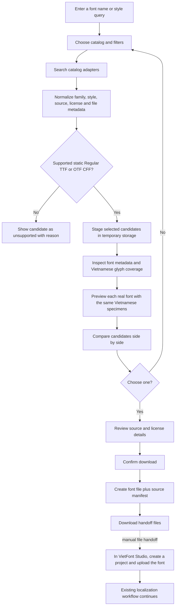

# Font Discovery & Compare — Feature/Module Blueprint

**Status:** Proposed MVP blueprint

**Purpose:** Copy this document into the new tool's repository as its starting feature and module plan.
**System boundary:** This is a standalone application. It does not share UI, API, database, runtime files, or code packages with VietFont Studio.

## 1. Product goal

Help a user find font families that lack some Vietnamese glyphs, inspect those fonts, compare their visual style side by side, and download a selected source font with enough provenance information to import it manually into a separate font-localization system.

The discovery tool does not create Vietnamese glyphs, revisions, QA results, or final Vietnamese fonts. Those remain the responsibility of the existing VietFont Studio after the user imports the selected `.ttf` or `.otf` file there.

## 2. System boundary and handoff

- Run as its own application with its own frontend, backend, configuration, database, cache, and file storage.
- Do not call VietFont Studio's internal API, read its `.data` folder, or write to its database.
- Search catalogs through explicit adapters. Do not build an unrestricted web scraper or accept arbitrary filesystem paths as downloads.
- Recommended implementation baseline: React + TypeScript + Vite, FastAPI + Python, and a separate SQLite database with managed local temp/cache files. This is a proposal for familiarity, not a shared runtime; keep ports, environment variables, dependencies, and Docker volumes independent.
- Recommended MVP deployment assumption: single-user local app. A hosted deployment target has not been chosen; hosting later would need a separate review of storage, download limits, and access controls.
- The proposed MVP handoff contains the font file and `source-manifest.json`. The user downloads both, then uploads the font file using VietFont Studio's New Project flow. The current system does not ingest the manifest; retain it beside the font for attribution and license traceability.
- Include SHA-256 and catalog identity in the manifest. The discovery tool can deduplicate its own cache, but cannot check for duplicates in VietFont Studio without a future explicit import contract.
- The discovery and comparison flow does not need an AI provider. Catalog metadata, fontTools inspection, and deterministic filters/ranking are sufficient for the MVP.

### Handoff manifest

```json
{
  "schema_version": 1,
  "catalog": "catalog-adapter-id",
  "catalog_font_id": "upstream-id-or-null",
  "family": "Font family",
  "style": "Regular",
  "format": "ttf",
  "source_url": "https://catalog.example/font",
  "license_name": "Catalog-provided license label",
  "license_url": "https://catalog.example/license",
  "sha256": "hex digest",
  "downloaded_at": "ISO-8601 timestamp"
}
```

The manifest records catalog claims; it must not reinterpret them as legal advice or invent a license when the source does not provide one.

## 3. User workflow



### User decisions the UI must support

- Search by family/name and optional descriptive terms.
- Filter by source catalog, family/category, style/weight, file format, license metadata, and Vietnamese coverage state.
- Inspect why a font is considered incomplete: show required-character coverage, missing characters, format, family/style, source, and license.
- Compare at least two candidates using the same sample strings, size, line-height, and preview settings.
- Select a candidate only after the user can inspect its source and license details.
- Cancel or clear staged candidates; temporary font files are cleaned up on cancellation and by a TTL job.

## 4. Feature-based frontend modules

Recommended tree:

```text
frontend/src/
├── app/
│   ├── App.tsx
│   ├── router.tsx
│   ├── layouts/
│   └── providers/
├── features/
│   ├── catalog-search/
│   │   ├── api/
│   │   ├── components/       # query bar, filters, result list, paging
│   │   ├── hooks/
│   │   ├── model/            # query/filter/result types and schemas
│   │   ├── pages/
│   │   └── utils/
│   ├── catalog-sources/     # adapter status and source-specific metadata
│   ├── candidate-inspection/ # metadata, format and coverage presentation
│   ├── font-preview/         # local @font-face specimen renderer
│   ├── font-comparison/     # compare tray, columns and selected candidate
│   ├── handoff/              # license acknowledgement and file downloads
│   └── settings/             # source enablement and cache limits
├── shared/
│   ├── api/
│   ├── hooks/
│   ├── i18n/
│   ├── lib/
│   ├── types/
│   └── ui/
└── main.tsx
```

Feature responsibilities:

| Feature | Owns |
|---|---|
| `catalog-search` | Search form, filters, results, paging, loading/error/empty states |
| `catalog-sources` | Catalog registry state, supported fields and source-specific metadata labels |
| `candidate-inspection` | Font metadata, supported format state, Vietnamese coverage and missing glyph list |
| `font-preview` | Rendering the actual staged font in repeatable Vietnamese sample strings |
| `font-comparison` | Compare selection, synchronized specimen settings, remove/swap candidates |
| `handoff` | Source/license review, user confirmation, manifest and font downloads |
| `settings` | Enabled catalogs, cache size/retention, and local data location display |

Use a compact dashboard shell, but keep this tool's brand and navigation separate from VietFont Studio. A mobile comparison view should stack candidate panels while preserving identical sample text and visible labels.

## 5. Backend/service modules

Recommended tree:

```text
backend/app/
├── main.py                    # FastAPI construction and SPA/static hosting if needed
├── api/
│   ├── routes/
│   │   ├── catalogs.py
│   │   ├── search.py
│   │   ├── candidates.py
│   │   ├── comparisons.py
│   │   ├── handoffs.py
│   │   └── jobs.py
│   └── schemas/
├── catalogs/
│   ├── base.py                 # CatalogAdapter protocol
│   ├── registry.py
│   └── adapters/               # one connector per approved catalog
├── search/                     # query normalization, filters and pagination
├── inspection/
│   ├── font_reader.py          # metadata and outline format
│   ├── vietnamese_coverage.py  # canonical required character set and coverage
│   └── supported_formats.py
├── preview/                    # safe serving of staged font bytes
├── comparison/                 # session state and deterministic ranking
├── handoff/                     # manifest schema, hash, package/download
├── storage/                    # SQLite, temp files, cache and cleanup
├── jobs/                       # progress for slow catalog/download/inspection work
└── security/                   # URL and download policy
```

### Backend module contracts

- **Catalog adapter:** `search(query, filters, page)` returns normalized catalog references and source/license metadata. `download(candidate_ref)` streams a font into managed temporary storage; it never accepts a user-supplied local path.
- **Search service:** validates filters, queries enabled adapters, normalizes results, and records enough state to inspect or compare a result later.
- **Inspection service:** reads metadata and glyph cmap locally; computes required-character presence from a versioned Vietnamese character set; reports unsupported outlines clearly.
- **Preview service:** provides short-lived same-origin URLs for staged font files. Do not make font content public beyond the current app session.
- **Comparison service:** keeps candidate order and shared specimen settings; ranking is deterministic and explains its factors.
- **Handoff service:** requires the user to confirm the selected source/license details, computes SHA-256, writes the manifest, and returns the selected font and manifest as downloads.
- **Storage service:** owns a database and temp/cache directory unique to this tool. It expires staged files and associated preview URLs.
- **Job service:** reports progress/error for operations that exceed a normal request duration; it does not create a permanent task-history product screen unless that is later requested.

## 6. Data model proposal

- `Catalog`: stable adapter ID, display name, enabled state, and adapter-specific configuration that contains no secrets unless the catalog requires authentication.
- `CandidateRef`: catalog ID, upstream candidate ID, source/download URLs, family/style/category, format/weight metadata, license label/URL, and last-seen time.
- `StagedFont`: candidate reference, managed temp path, SHA-256, detected format, metadata inspection, coverage report, status, and expiry time.
- `ComparisonSession`: candidate IDs in display order, specimen settings, created/updated times, and optional user note.
- `HandoffRecord`: chosen candidate, manifest, file hash, and creation time; the actual file expires according to the configured cache policy unless explicitly retained.

Do not mirror every font from an upstream catalog into SQLite. Persist search/session data only as long as needed for comparison, and retain font binaries only in managed temporary/cache storage.

## 7. API proposal

These are logical resources; keep actual route naming consistent and versionable when implementation starts.

| Method | Route | Purpose |
|---|---|---|
| `GET` | `/api/catalogs` | List enabled catalog adapters and available filters |
| `POST` | `/api/searches` | Create a search and return normalized candidates |
| `GET` | `/api/searches/{search_id}` | Read search results/status |
| `DELETE` | `/api/searches/{search_id}` | Clear search state and related temporary candidates |
| `POST` | `/api/candidates/{candidate_id}/inspect` | Stage and inspect a catalog font |
| `GET` | `/api/candidates/{candidate_id}` | Read candidate metadata and inspection report |
| `POST` | `/api/comparisons` | Create a comparison from inspected candidates |
| `GET` | `/api/comparisons/{comparison_id}` | Read comparison and specimen settings |
| `PUT` | `/api/comparisons/{comparison_id}` | Update candidate order/specimen settings |
| `DELETE` | `/api/comparisons/{comparison_id}` | Delete a comparison and release references |
| `POST` | `/api/handoffs` | Confirm selection and prepare the handoff record |
| `GET` | `/api/handoffs/{handoff_id}/font` | Download the selected font file |
| `GET` | `/api/handoffs/{handoff_id}/manifest` | Download provenance/license manifest |
| `GET` | `/api/jobs/{job_id}` | Read progress for asynchronous operations |

Search and comparison records are user-managed resources and should have create/read/update/delete behavior where those operations apply. Downloads, inspection, and jobs are action/status endpoints. Do not create an API that reaches into VietFont Studio.

## 8. Search, coverage and ranking rules

- Catalog metadata is a discovery hint; inspect the actual font file before claiming coverage or format support.
- For handoff into the current localization engine, mark static Regular TTF and OTF CFF as supported. Clearly label unsupported style/outline formats rather than silently suggesting they will import successfully.
- Define one versioned required Vietnamese character set in this tool. Keep it explicit and test normalization, combining marks, and precomposed characters. Do not assume a catalog's `language=Vietnamese` tag proves full coverage.
- Show `present / required`, percentage, and the actual missing characters. Keep catalog language tags separate from measured glyph coverage.
- A coverage filter should support at least: complete, incomplete, and unknown. The product goal prioritizes incomplete fonts, but users must be able to inspect all candidates.
- Rank only by explainable factors such as query/style match, chosen filters, format compatibility, and coverage state. Do not equate lower coverage with a better-looking design.
- Preview the actual font file. Never draw replacement glyphs or use a fallback font while claiming the candidate supports that character; identify fallback/missing glyphs in the preview.

## 9. Safety, license and operations

- Use catalog adapters with known source domains. Validate redirects and resolved addresses; block loopback, private, link-local, and other non-public targets to prevent SSRF.
- Enforce request timeout, redirect limit, maximum byte size, and actual file-signature checks. Do not trust a filename, MIME type, or extension alone.
- Treat catalog metadata and license text as untrusted display data: escape it in the UI and preserve the original source URL.
- If license information is missing, show it as unknown and require the user to review the source before handoff. Never label a font commercial-use/free unless the source explicitly provides that information.
- Keep temporary fonts in the tool's managed cache, outside static web roots. Clean up on cancel, expiry, and application shutdown where practical.
- Do not upload candidate fonts to an AI provider or to VietFont Studio. The handoff happens only after the user selects and downloads a candidate.
- Keep environment variables, data directory, local port, and Docker volume names distinct from VietFont Studio.

## 10. MVP acceptance criteria

1. A user can search at least one approved catalog and see clear loading, empty, partial-error, and retry states.
2. Unsupported or unknown-format candidates are labeled accurately and cannot be handed off as supported fonts.
3. For supported candidates, the tool inspects the actual file and reports metadata, Vietnamese coverage, and missing glyphs.
4. A user can compare multiple actual fonts using identical samples and can identify any missing/fallback characters.
5. Source and license details are visible before the user confirms a handoff.
6. Handoff downloads the original selected font plus a valid manifest with a correct SHA-256; no font generation occurs in this tool.
7. Cancelled/expired candidate files are removed from temporary storage; no direct coupling to VietFont Studio data or APIs exists.
8. Search, inspection, preview, and handoff remain usable without connecting an AI provider.

## 11. Suggested implementation order

1. Scaffold standalone app/API with separate environment, storage, and health endpoint.
2. Define `CatalogAdapter`, schemas, catalog registry, and one approved connector.
3. Implement secure download staging and deterministic font inspection/coverage.
4. Build search results and actual-font preview.
5. Build side-by-side comparison and explainable filters/ranking.
6. Add license confirmation, manifest/hash generation, and file downloads.
7. Add expiration cleanup, cache settings, responsive states, and operational checks.

Do not start multiple catalog integrations before the adapter contract and inspection path work end to end with one catalog.
