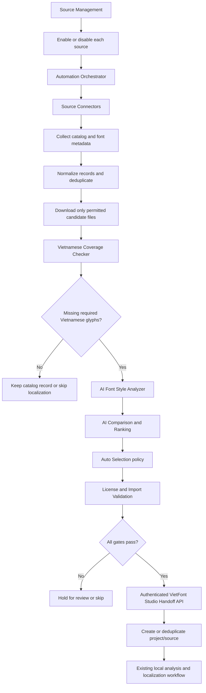
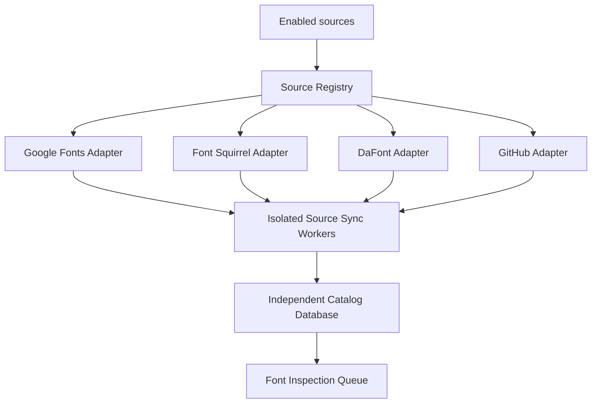
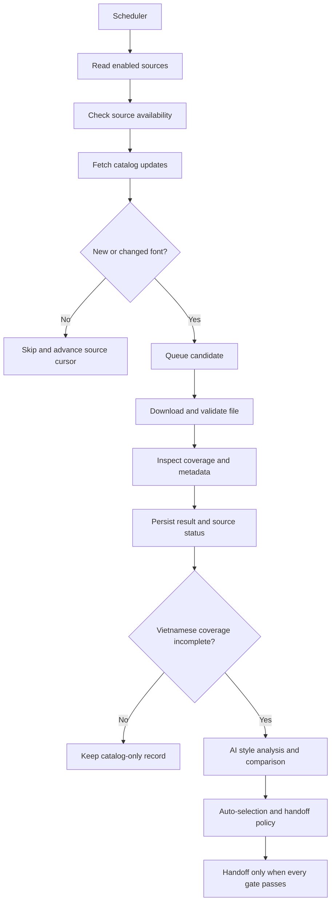
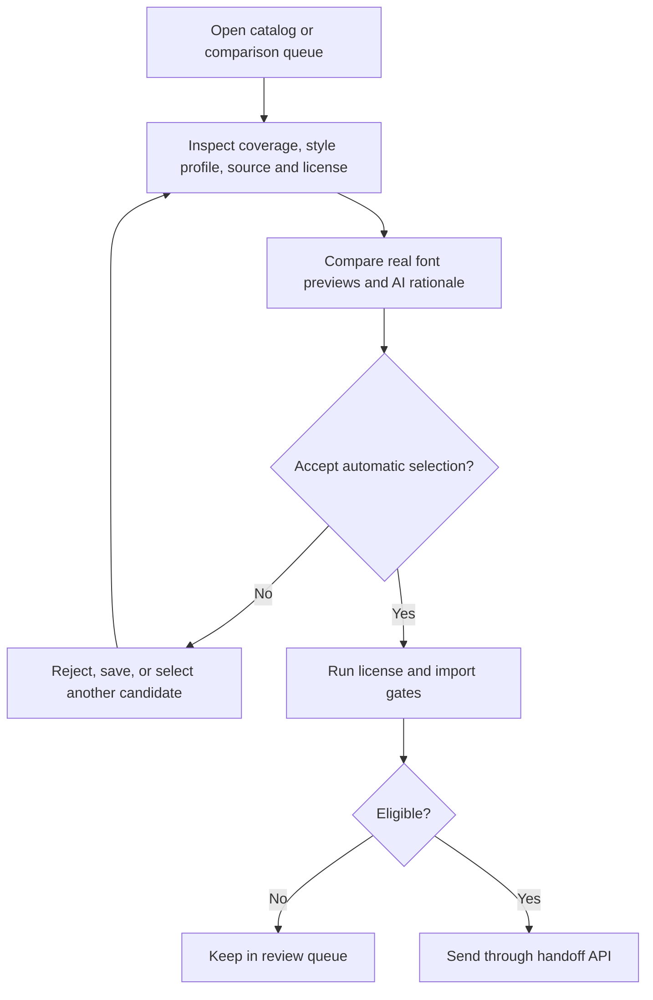

# Font Discovery & Compare — Feature/Module Blueprint

**Status:** Automated Font Discovery V2 architecture

**Purpose:** Copy this document into the new tool's repository as its starting feature and module plan.
**System boundary:** This is a standalone application. It does not share UI, API, database, runtime files, or code packages with VietFont Studio.

## 1. Product goal

Automatically sync enabled font sources, find new or changed font files, inspect their Vietnamese coverage, use AI to compare and rank eligible fonts, and send selected fonts through a narrow handoff API into the separate VietFont Studio system.

The discovery tool does not create Vietnamese glyphs, revisions, QA results, or final Vietnamese fonts. Those remain the responsibility of VietFont Studio after it receives an eligible source font.

## 2. System boundary and handoff

- Run as its own application with its own frontend, backend, configuration, database, cache, and file storage.
- Do not share databases, runtime files, or code packages with VietFont Studio. The only system-to-system connection is a dedicated, authenticated font-handoff API.
- Search catalogs through explicit adapters. Do not build an unrestricted web scraper or accept arbitrary filesystem paths as downloads.
- Recommended implementation baseline: React + TypeScript + Vite, FastAPI + Python, and a separate SQLite database with managed local temp/cache files. This is a proposal for familiarity, not a shared runtime; keep ports, environment variables, dependencies, and Docker volumes independent.
- Recommended MVP deployment assumption: single-user local app. A hosted deployment target has not been chosen; hosting later would need a separate review of storage, download limits, and access controls.
- Each source has independent enabled/disabled state, sync cursor, rate limit, and error status. A failure in one connector must not stop the other sources.
- AI analysis/comparison is a separate provider integration owned by this app. Sync and local coverage inspection can continue when AI is unavailable, but selection and handoff must wait for AI or enter a review queue.
- AI receives normalized metadata and local style/coverage measurements, not the font binary, local path, or raw glyph outlines.
- Auto-selection and auto-handoff run only when the source policy is enabled and all compatibility, coverage, confidence, deduplication, and license-evidence gates pass.

### Handoff contract

The discovery backend sends the selected original `.ttf`/`.otf` bytes and a provenance manifest through a dedicated receiver endpoint in VietFont Studio. The two systems remain independently deployable and keep separate databases. Do not use a shared folder as the integration mechanism.

The manifest contains source identity/URL, source font ID, family/format, source-provided license data and review acknowledgements, SHA-256, discovery record ID, measured coverage, AI coverage classification, user confirmation, selection rationale, and timestamp. The sender also supplies an `Idempotency-Key` derived from discovery record ID and SHA-256. The receiver validates both, creates or identifies the destination project/source record, stores provenance, and queues the existing local analysis. The font is not passed to a cloud AI provider.

**Receiver implementation:** VietFont Studio implements `POST /api/integrations/font-discovery/handoffs`. It accepts multipart fields `font` (font bytes) and `manifest` (JSON text), requires `Authorization: Bearer <FONT_DISCOVERY_BEARER_TOKEN>` and an `Idempotency-Key` header, verifies file signature and SHA-256, requires confirmed missing coverage and user review acknowledgements, deduplicates by discovery record ID/content hash, creates or identifies the project, and queues local source analysis. Configure the matching sender token only on the two backends; see the main project README for the receiver contract and response behavior.

```json
{
  "schema_version": 1,
  "source": "google_fonts",
  "source_font_id": "upstream-id-or-null",
  "discovery_record_id": "stable-local-id",
  "family": "Font family",
  "format": "ttf",
  "source_url": "https://catalog.example/font",
  "license_name": null,
  "license_url": null,
  "license_status": "unknown",
  "sha256": "hex digest",
  "coverage": {"present": 40, "required": 134, "percent": 29.9},
  "coverage_classification": {
    "classification": "missing",
    "fonttools_classification": "missing",
    "ai_classification": "missing",
    "confidence": 0.9,
    "rationale": "The report confirms missing Vietnamese characters."
  },
  "selection_reason": "Selected by the user after reviewing Vietnamese coverage.",
  "candidate_reviewed_by_user": true,
  "license_acknowledged_by_user": true,
  "source_terms_acknowledged_by_user": true,
  "created_at": "2026-11-01T12:00:00+00:00"
}
```

The manifest records catalog claims; it must not reinterpret them as legal advice or invent a license when the source does not provide one. A signed URL or temporary download token must never be stored in the manifest.

## 3. Automated V2 flow



### Source connector and catalog flow



These are candidate connectors from the diagram, not a claim that each source has an approved API or identical download/license terms. Assess each source's access method, rate limits, terms, and licensing evidence before enabling its adapter.

### Scheduled sync and change detection



### Ecosystem boundary


## 4. Interactive review workflow

Automation is the primary V2 path; keep a user-facing catalog and comparison view for oversight, search, and manual override.



### User decisions the UI must support

- Search by family/name and optional descriptive terms.
- Filter by source catalog, family/category, style/weight, file format, license metadata, and Vietnamese coverage state.
- Inspect why a font is considered incomplete: show required-character coverage, missing characters, format, family/style, source, and license.
- Compare at least two candidates using the same sample strings, size, line-height, and preview settings.
- Review the automatic selection and its AI rationale; allow a user to override, reject, or hold a candidate.
- Show source and license evidence before any manual or automatic handoff. Unknown or conflicting evidence must require review.
- Cancel or clear staged candidates; temporary font files are cleaned up on cancellation and by a TTL job.

## 5. Feature-based frontend modules

Recommended tree:

```text
frontend/src/
├── app/
│   ├── App.tsx
│   ├── router.tsx
│   ├── layouts/
│   └── providers/
├── features/
│   ├── source-management/
│   │   ├── api/
│   │   ├── components/
│   │   ├── hooks/
│   │   ├── model/
│   │   ├── pages/
│   │   └── utils/
│   ├── sync-monitor/           # schedule, per-source sync state and failures
│   ├── catalog-search/
│   │   ├── api/
│   │   ├── components/       # query bar, filters, result list, paging
│   │   ├── hooks/
│   │   ├── model/            # query/filter/result types and schemas
│   │   ├── pages/
│   │   └── utils/
│   ├── candidate-inspection/ # metadata, format and coverage presentation
│   ├── font-preview/         # local @font-face specimen renderer
│   ├── ai-style-analysis/    # AI style profile and eligibility signals
│   ├── font-comparison/      # compare tray, AI ranking and rationale
│   ├── auto-selection/       # policy thresholds, review queue and overrides
│   ├── handoff/              # target connection, push status and retry
│   ├── provider-settings/    # discovery app's own AI provider and model
│   └── settings/             # sync, license, cache and retention policies
├── shared/
│   ├── api/
│   ├── hooks/
│   ├── i18n/
│   ├── lib/
│   ├── types/
│   └── ui/
└── main.tsx
```

Each feature owns its API calls, hooks, UI, schemas/types, and feature-specific helpers. Keep `shared/` for genuinely reusable primitives and transport utilities; do not move business rules shared by only two features into a generic layer.

Feature responsibilities:

| Feature | Owns |
|---|---|
| `source-management` | Source registry; enable/disable and configure each connector independently |
| `sync-monitor` | Scheduler/manual sync state, source cursor, last success, isolated errors and retries |
| `catalog-search` | Search form, filters, catalog results, paging, loading/error/empty states |
| `candidate-inspection` | Font metadata, supported format state, Vietnamese coverage and missing glyph list |
| `font-preview` | Rendering the actual staged font in repeatable Vietnamese sample strings |
| `ai-style-analysis` | Display AI profile, style match, confidence and rationale |
| `font-comparison` | Compare real previews with AI ranking and explanations |
| `auto-selection` | Configure policy thresholds, manual override and review-required cases |
| `handoff` | Authenticate to VietFont Studio, submit font/manifest, show result and retry safely |
| `provider-settings` | Configure this app's separate provider credentials and model |
| `settings` | Sync interval, license policy, cache limits and retention |

Use a compact dashboard shell, but keep this tool's brand and navigation separate from VietFont Studio. A mobile comparison view should stack candidate panels while preserving identical sample text and visible labels. Make each source's enabled state and latest sync outcome clear; one failing source must not make other sources appear unavailable.

## 6. Backend/service modules

Recommended tree:

```text
backend/app/
├── main.py                    # FastAPI construction and SPA/static hosting if needed
├── api/
│   ├── routes/
│   │   ├── sources.py
│   │   ├── sync.py
│   │   ├── catalog.py
│   │   ├── search.py
│   │   ├── candidates.py
│   │   ├── comparisons.py
│   │   ├── selection.py
│   │   ├── handoff.py
│   │   └── jobs.py
│   └── schemas/
├── sources/
│   ├── base.py                 # SourceConnector protocol
│   ├── registry.py
│   └── adapters/               # independent adapter per approved source
├── orchestration/              # scheduler, source coordinator and run lifecycle
├── sync/                       # workers, checkpoints, retries and change detection
├── catalog/                    # normalized records, dedupe and catalog persistence
├── search/                     # query normalization, filters and pagination
├── inspection/
│   ├── queue.py                # bounded inspection work queue
│   ├── font_reader.py          # metadata and outline format
│   ├── vietnamese_coverage.py  # canonical required character set and coverage
│   └── supported_formats.py
├── preview/                    # safe serving of staged font bytes
├── ai/                         # style analysis and AI comparison/ranking
├── comparison/                 # candidate set, score aggregation and rationale
├── selection/                  # configurable auto-selection policy
├── licensing/                  # license evidence and import eligibility rules
├── handoff/                    # authenticated client, manifest, hash/idempotency
├── providers/                  # this app's independent AI-provider credentials
├── storage/                    # SQLite, temp files, cache and cleanup
├── jobs/                       # progress for slow catalog/download/inspection work
└── security/                   # URL and download policy
```

### Backend module contracts

- **Source registry:** stores connector identity, enabled state, source-specific configuration, rate limit, last cursor, and health. Enabling/disabling one adapter does not mutate the others.
- **Source connector:** exposes `check_availability()`, `fetch_catalog(cursor)`, and `download(candidate_ref)`. It returns normalized metadata and a source/license reference; it never accepts a user-provided local path.
- **Automation orchestrator:** runs scheduled and user-triggered syncs, creates isolated worker runs per source, advances cursors only after successful processing, and allows one connector to fail independently.
- **Catalog sync worker:** normalizes records, detects new/changed entries using source ID and content hash, deduplicates, persists catalog state, and enqueues permitted files for inspection.
- **Inspection/coverage service:** validates actual font signatures and formats, reads metadata and cmap locally, computes required-character presence from a versioned Vietnamese set, and reports unsupported outlines clearly.
- **AI style analyzer:** consumes normalized metadata and locally computed style/geometry descriptors; returns a schema-validated style profile, compatibility score, confidence, and rationale.
- **AI comparison/ranking service:** compares only eligible candidates and returns explainable scores. Store model/provider provenance with the result; do not send font bytes, raw outlines, local paths, or signed download URLs.
- **Auto-selection policy:** requires incomplete Vietnamese coverage, supported format, configured style/quality thresholds, sufficient model confidence, no duplicate, and acceptable license evidence. Anything uncertain goes to review.
- **License/import validator:** checks that source/license evidence is present and permitted by the configured policy, validates file integrity/format, and prepares a reason-coded pass/review/reject result. It must not claim to make a legal determination.
- **Handoff client:** sends the font bytes and manifest to the dedicated VietFont Studio receiver with scoped authentication, SHA-256, and an idempotency key. It records the response and retries safely.
- **Storage service:** owns a database and temp/cache directory unique to this tool. It persists source cursors, catalog state, analyses, policies, and handoff status, and expires staged font files and preview URLs.
- **Job service:** reports progress/error for sync, download, inspection, AI analysis, and handoff operations. Keep run status per source and operation; no cross-system job-history UI is required.

## 7. Data model proposal

- `SourceConnector`: stable adapter ID, display name, enabled state, source-specific non-secret settings, rate-limit policy, health, and last successful cursor. Built-in connectors are independently enabled; arbitrary user-supplied fetch URLs are out of scope.
- `SyncRun`: source ID, trigger, cursor range, start/end time, status, counters, retry/error summary, and worker correlation ID.
- `CatalogFont`: source/upstream IDs, normalized family/style/category/format metadata, source page URL, source license evidence, content hash when fetched, and first/last-seen timestamps. Do not mirror complete upstream catalogs without a product need.
- `FontArtifact`: managed temporary object key, SHA-256, detected format, inspection state, byte size, and expiry; never expose its local path.
- `CoverageReport`: required-character-set version, cmap results, present/required counts, percentage, and missing code points/characters.
- `StyleAnalysis`: normalized local descriptors, provider/model provenance, structured style profile, compatibility score, confidence, and rationale. No font binary or raw outline is stored in the AI request record.
- `ComparisonResult`: candidate IDs, normalized score factors, ranked order, explanation, model/prompt version, and created time.
- `SelectionDecision`: policy version, selected candidate, pass/review/reject outcome, reason codes, and whether automation or a user made the decision.
- `LicenseEvidence`: source-provided label and URL, retrieval time, evidence status, and configured policy result. It records source evidence and is not a legal opinion.
- `HandoffRecord`: discovery record ID, SHA-256/idempotency key, manifest, target response, state, retry count, and timestamps. Retain the font artifact only under the configured cache policy.

Keep source cursors, deduplication keys, policies, and handoff status durable. Expire staged font bytes and generated previews independently from catalog metadata so a catalog record can remain after its temporary file is removed.

## 8. API proposal

These are logical resources and action routes. Keep route naming versionable. Approved built-in connectors are registered by code, so the API manages their settings and enabled state rather than accepting arbitrary source URLs.

| Method | Route | Purpose |
|---|---|---|
| `GET` | `/api/sources` | List registered source connectors and enabled/health state |
| `GET` | `/api/sources/{source_id}` | Read connector configuration and last sync state |
| `PUT` | `/api/sources/{source_id}` | Update enablement and allowed connector settings |
| `DELETE` | `/api/sources/{source_id}/configuration` | Reset a connector's optional configuration; built-in adapter code is not deleted |
| `POST` | `/api/sync-runs` | Start a manual sync for selected enabled sources |
| `GET` | `/api/sync-runs` | List recent sync runs and per-source outcomes |
| `GET` | `/api/sync-runs/{run_id}` | Read sync progress, counters, and errors |
| `DELETE` | `/api/sync-runs/{run_id}` | Request cancellation of a running sync |
| `GET` | `/api/catalog/fonts` | Search and filter normalized catalog records |
| `GET` | `/api/catalog/fonts/{font_id}` | Read source metadata and current inspection state |
| `DELETE` | `/api/catalog/fonts/{font_id}` | Remove a locally managed catalog record and its staged artifact |
| `POST` | `/api/catalog/fonts/{font_id}/inspect` | Queue secure download, metadata parsing, and coverage inspection |
| `GET` | `/api/coverage-reports/{report_id}` | Read measured Vietnamese coverage and missing characters |
| `POST` | `/api/comparisons` | Create an AI-assisted comparison for inspected candidates |
| `GET` | `/api/comparisons/{comparison_id}` | Read ranked candidates, score factors, and rationale |
| `PUT` | `/api/comparisons/{comparison_id}` | Change candidates/specimen settings and request reranking |
| `DELETE` | `/api/comparisons/{comparison_id}` | Delete a comparison and release its temporary references |
| `GET` | `/api/selection-policies` | Read automatic selection and handoff policy |
| `PUT` | `/api/selection-policies/{policy_id}` | Update thresholds and review requirements |
| `POST` | `/api/selections` | Evaluate candidates against the current policy; never bypass hard gates |
| `GET` | `/api/selections/{decision_id}` | Read decision and reason codes |
| `PUT` | `/api/selections/{decision_id}` | Record a user override or review outcome |
| `POST` | `/api/handoffs` | Start an authenticated, idempotent push of font and manifest to VietFont Studio |
| `GET` | `/api/handoffs/{handoff_id}` | Read receiver status and retry/error details |
| `POST` | `/api/handoffs/{handoff_id}/retry` | Retry a failed handoff using the same idempotency key |
| `GET` | `/api/jobs/{job_id}` | Read progress for asynchronous inspection/AI/handoff operations |

User-managed resources should expose create/read/update/delete where the operation makes sense. Sync, inspect, compare, evaluate, and handoff are commands with status resources, not generic CRUD mutations. Never let the Discovery API query or mutate VietFont Studio's database directly.

### VietFont Studio receiver contract

The receiver is implemented in the VietFont Studio backend at `POST /api/integrations/font-discovery/handoffs`. It accepts multipart `font` and JSON-text `manifest` fields, requires the configured Bearer token plus the sender's `Idempotency-Key`, validates size/format/hash/coverage, and deduplicates by discovery record ID plus content hash. It returns the existing project for duplicate bytes, otherwise creates a project/source and queues the existing local analysis. Keep the matching token on the Discovery and VietFont Studio backends; never put it in browser code. See the main project README for configuration and response codes.

## 9. Search, coverage and ranking rules

- Catalog metadata is a discovery hint; inspect the actual font file before claiming coverage or format support.
- For the initial handoff path, mark static Regular TTF and OTF CFF as supported only after a receiver compatibility check. Clearly label unsupported style/outline formats rather than silently suggesting they will import successfully.
- Define one versioned required Vietnamese character set in this tool. Test normalization, combining marks, and precomposed characters. A catalog language tag never proves full coverage.
- Show `present / required`, percentage, and the actual missing characters. Keep catalog language tags separate from measured glyph coverage.
- Coverage state must distinguish complete, incomplete, and unknown. The automatic discovery path prioritizes incomplete fonts; users can still inspect all candidates.
- Run AI style analysis only on metadata and locally derived, normalized descriptors. AI returns structured style labels, similarity/compatibility signals, confidence, and concise rationale.
- Combine AI ranking with deterministic factors such as requested style, family/category filters, supported format, and source quality. Show factor contributions and model provenance. AI ranking cannot override unsupported format, duplicate, coverage, or license gates.
- Lower coverage alone is not a style-quality signal. The target is a useful source with missing Vietnamese characters and a compatible visual style.
- Preview the actual font file. Never draw replacement glyphs or use a fallback font while claiming the candidate supports that character; identify fallback/missing glyphs in the preview.

## 10. Safety, license and operations

- Use approved source adapters with documented access methods. Verify each source's terms, rate limits, and license evidence before enabling it; example sources in the diagrams are candidates, not blanket approval.
- Validate redirects and resolved addresses; block loopback, private, link-local, and other non-public targets to prevent SSRF. Enforce request timeout, redirect limit, maximum byte size, and actual file-signature checks.
- Treat catalog metadata and license text as untrusted display data: escape it in the UI and preserve the original source URL.
- If license evidence is missing, conflicting, or ambiguous, mark it unknown/review-required and do not auto-handoff. The validator checks configured evidence policy; it does not make a legal determination.
- Keep temporary fonts in managed cache outside static web roots. Clean up on cancellation and expiry; never expose local paths or long-lived public URLs.
- Never send font binaries, raw outlines, local paths, or signed download URLs to an AI provider. A font binary is sent only to the explicitly configured VietFont Studio handoff receiver after policy approval.
- Require scoped authentication, TLS when crossing hosts, idempotency, SHA-256 verification, and retry-safe responses for the handoff API. Keep target credentials on the Discovery backend, never in browser code.
- Source sync, file inspection, and measured coverage may continue if AI is unavailable. In that state, queue candidates for review; do not auto-rank or auto-handoff them.
- Keep environment variables, data directory, local port, Docker volume names, and AI credentials distinct from VietFont Studio.

## 11. MVP acceptance criteria

1. A user can independently enable/disable each approved connector; one source's outage does not stop other source workers.
2. A scheduled sync detects new/changed catalog entries, skips unchanged entries, deduplicates repeated records, and reports per-source status and retryable failures.
3. Candidates are downloaded only through approved connector rules, validated by actual signature/format, and measured against a versioned Vietnamese character set.
4. Unsupported or unknown-format candidates, complete-coverage candidates, and duplicate content cannot pass the automatic selection gates.
5. AI produces explainable style analysis and comparison from metadata/normalized local measurements; AI unavailability blocks automatic ranking/handoff but not sync or coverage inspection.
6. Automatic selection requires all configured style/confidence thresholds plus passing coverage, format, deduplication, and license-evidence checks. Unknown/conflicting license evidence is routed to review.
7. Users can inspect real-font previews, compare candidates using identical specimens, and override or reject an automatic recommendation.
8. A passing candidate is sent to the separately authenticated VietFont Studio receiver with a provenance manifest, verified SHA-256, and idempotency key; the receiver revalidates and queues local font analysis.
9. Repeating a handoff or retrying after a network failure does not create duplicate imports. The Discovery tool never accesses VietFont Studio's database or local files directly.
10. Temporary files expire according to policy, and the UI clearly distinguishes catalog-only, inspection-ready, review-required, handoff-pending, and imported states.

## 12. Suggested implementation order

1. Scaffold the standalone app/API with distinct environment, database, temporary storage, scheduler, and health endpoint.
2. Define connector contracts, source registry, per-source configuration, run records, and one source adapter whose access and terms are verified.
3. Implement idempotent sync workers, cursor/checkpoint handling, metadata normalization, change detection, and deduplication.
4. Implement secure download staging, font signature/format inspection, and versioned Vietnamese coverage measurement.
5. Build catalog/search, per-source sync monitoring, candidate inspection, and real-font previews.
6. Add the Discovery app's AI provider settings, metadata-only style analyzer, comparison/ranking, and explainable results.
7. Add auto-selection policy, review queue, license/import evidence gates, and user override.
8. Define and implement the authenticated handoff sender, then add the dedicated receiver in VietFont Studio with hash/idempotency checks and local analysis queueing.
9. Add retention cleanup, responsive states, retry behavior, source isolation, and operational checks.

Start with one verified connector end to end before enabling multiple sources. Keep auto-handoff behind an explicit policy configuration until receiver compatibility, license evidence, and idempotency behavior have been verified.
