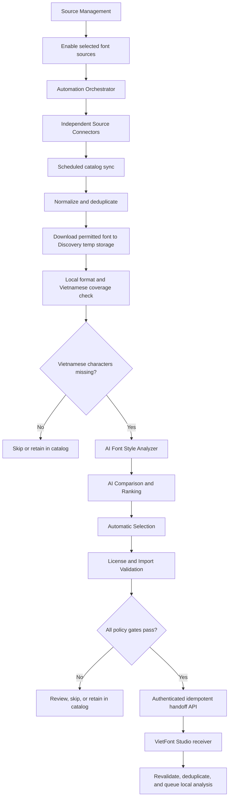

# VietFont Studio — Product and Engineering Spec

**Last reviewed:** 2026-10-31

**Purpose:** This is the first document an AI agent or contributor should read to understand the product, its boundaries, and current UX decisions. It replaces reliance on chat history. Verify implementation details against the source files linked below before changing them.

## Scout entry

When starting work in this repository:

1. Read this file, then the relevant feature module and its API/types.
2. Check the current source and package manifests. This spec describes intended behavior; code is the source of truth for what currently runs.
3. Keep changes inside the owning feature where practical. Shared UI, API transport, localization, and application routing belong under `frontend/src/shared/` or `frontend/src/app/`.
4. If implementation and an accepted product decision in this spec disagree, preserve the decision, fix the implementation, and update this spec when the decision changes.
5. Do not infer product requirements from old chat excerpts or from upstream kit branding.

## Product summary

VietFont Studio is a local-first, single-user web application for turning a static source font into a Vietnamese-ready TTF or OTF. A user imports and analyzes a font, connects an AI provider, compares three AI-generated design directions (VER 1A/1B/1C), reviews and refines glyphs, runs QA, and exports the approved revision.

The application is not a multi-user hosted service. The browser UI is served locally, while font files, SQLite data, font construction, vector editing, validation, and export run on the user's machine or in the user's local Docker container.

## Separate font discovery system

The Automated Font Discovery V2 tool is a **separate application** from VietFont Studio, not another feature or page inside it. It owns its UI, API, source connector registry, scheduler, database, AI provider settings, and temporary font storage. It must not share code, databases, local data directories, or internal runtime state with VietFont Studio. The only planned system connection is a narrow, authenticated font-handoff API.

Its automated flow manages independently enabled sources, syncs their catalogs, normalizes and deduplicates new/changed font records, downloads permitted candidates to its own temporary storage, and measures actual Vietnamese glyph coverage locally. Candidates with missing Vietnamese characters proceed to AI style analysis, AI-assisted comparison/ranking, automatic selection, and license/import validation. Candidates that already have complete coverage, are unsupported, duplicated, or fail policy gates are skipped, retained in the catalog, or routed for review as appropriate.

AI is required for style analysis, comparison, ranking, and automated selection/handoff. Sync, local format inspection, and coverage measurement can continue if the AI provider is unavailable, but those candidates must wait for review and cannot be auto-handed off. AI receives normalized metadata and locally derived descriptors only; font binaries, raw outlines, local paths, and signed download URLs stay out of AI requests.

The standalone feature/module tree, source and scheduler flows, API proposal, security rules, and MVP criteria are in [font-discovery-tool-modules.md](font-discovery-tool-modules.md). It is the blueprint for building the tool in a new, separate directory; whether that directory becomes its own Git repository is an implementation choice. These modules are not part of this running application.

### Handoff boundary

When the Discovery tool marks a candidate eligible and required user/license review is recorded, its backend sends the selected original `.ttf`/`.otf` and provenance manifest to `POST /api/integrations/font-discovery/handoffs` in VietFont Studio. The endpoint accepts multipart `font` and JSON-text `manifest` fields and requires `Authorization: Bearer <FONT_DISCOVERY_BEARER_TOKEN>` plus the sender's `Idempotency-Key`. It verifies the signature, SHA-256, missing-coverage classification, and review acknowledgements; detects repeated discovery IDs and identical imported bytes; creates or identifies the project/source record; and queues VietFont Studio's existing local analysis. Configure the matching token on both backends only; the Discovery browser must not hold it. See the main README for the complete request and response contract.

Neither application may access the other's database or local storage directly. The receiver is disabled until its Bearer token is configured.



## Product workflow

1. **Create a project and import a source font.** Accept `.ttf` and `.otf` files within the backend upload limit. Read font metadata and coverage locally.
2. **Analyze the source.** Record source metadata, glyph coverage, metrics, and supported outline format. Source coverage is a baseline and remains separate from any revision's QA results.
3. **Generate design directions with AI.** A connected provider and selected model are required. AI analyzes normalized font style information and proposes three distinct directions:
   - **VER 1A:** conservative placement; preserve existing mark positioning where practical.
   - **VER 1B:** explore a higher/top-stacked placement for tone marks to improve separation.
   - **VER 1C:** explore an alternative question-mark hook while keeping the design within the source style.

   These directions must reflect actual provider output and must differ in their design intent. Do not replace AI generation with canned or rule-only mock results.
4. **Review and refine.** The user chooses a direction, compares Vietnamese samples, sends feedback for AI refinement, or manually edits glyph contours and metrics in the vector editor. Each refinement creates a revision; retain prior revisions.
5. **Validate and export.** Run QA against the selected revision, approve that revision, build the requested TTF/OTF, and make the resulting file available to download. Do not mark a QA stage complete unless its check actually ran and passed.
6. **Back up an export (optional).** The backup page handles exported font files only. Google Drive upload starts only after the user connects, selects a destination, and initiates the sync.

## AI and local processing boundary

- AI participation is mandatory for initial VER generation and AI refinement. Local rules remain mandatory processing logic, but they do not substitute for AI output.
- AI may receive normalized font metadata, selected normalized measurements, the chosen VER, and user feedback needed for the requested design task.
- Source font binaries, local filesystem paths, and raw glyph outlines stay local during AI analysis and refinement.
- Local rules constrain and map proposed design parameters; local font tooling creates and edits outlines, builds fonts, validates them, and exports files.
- ChatGPT connects through the ChatGPT sign-in/OAuth flow. Ollama Cloud connects with an API key. Keep provider integration extensible so another provider can be added behind the existing provider boundary.
- Provider credentials belong in the operating-system credential store, never SQLite, frontend storage, logs, or committed environment files. Docker uses its persistent GNOME Keyring volume.
- Google Drive backup is an explicit exception for file transfer: only after user action is the selected exported font sent to the chosen Drive destination. The Drive access token is kept in page memory, not persisted as a refresh token.

## UX and content decisions

These are accepted product decisions. Preserve them unless the product owner changes them.

- The interface supports Vietnamese and English, defaults to Vietnamese, and localizes the embedded glyph editor as well as the main application.
- Use Fraunces as the single application typeface, including UI text. Font previews may use the user's source or generated font where explicitly intended.
- Use the VietFont Studio brand. Do not show the upstream tool vendor's name or branding in user-facing product copy. Internal environment variable names and vendored source paths are implementation details.
- Keep the application feature-based. Reusable components belong in shared UI; feature-specific screens and behavior stay with their feature.
- Project rename/delete controls belong on project-list cards near the lower-right action area. Do not duplicate those controls in the project detail header.
- Project detail is for reviewing the font and continuing the workflow. Do not show project rename/delete, source-font delete, or existing-analysis edit/delete controls there. Keep source upload/replacement and the action to create analysis when it is missing.
- VER cards are navigational previews only: no inline rename/delete controls. Preserve their original card design and keep each card link as the grid item directly inside `.variant-grid`; do not wrap it in another block element. If preview `<style>` nodes are emitted beside the links, keep per-variant sample selectors aligned with the rendered siblings.
- Do not render a task-history section on project detail. Active job progress remains visible through `JobWatch`; job status and CRUD API endpoints remain available to the system.
- Keep source-font coverage and selected-revision coverage visibly distinct. Completing the four workflow stages does not rewrite source analysis. Show revision coverage/QA as a separate result so users do not mistake the source baseline for the exported font's coverage.
- QA labels must reflect real checks. Geometry/rendering checks are not passed merely because an earlier parsing or coverage check passed.
- Keep screens responsive at desktop and narrow widths. Respect `prefers-reduced-motion`; do not animate the glyph canvas itself.
- Preserve user-facing privacy copy only where it helps the user understand a real data flow. Avoid redundant local-engine/provider status cards or promotional explanation blocks.

## Application architecture

### Frontend

The frontend is React + TypeScript + Vite. It uses Tailwind CSS v4 and project CSS tokens, shadcn-style copy-in primitives built on Radix UI, copy-in Magic UI components (`MagicCard`, `NumberTicker`), Motion for UI transitions, GSAP for the dashboard hero entrance, and Lucide React icons. i18next/react-i18next provide localization. `AutoAnimate` is intentionally not used.

The code is organized by feature:

- `frontend/src/app/`: app shell, routing, layouts, providers, and global styles.
- `frontend/src/features/`: dashboard, projects, import, analysis, variants, glyph studio, revisions, validation, export, AI providers, published fonts, and backups.
- `frontend/src/shared/`: UI primitives, hooks, API transport, types, utilities, constants, and localization.

Prefer each feature's `index.ts` public exports when importing across features; check existing conventions where a feature has no index export. Current route definitions are in `frontend/src/app/router.ts` and `frontend/src/shared/constants/routes.ts`.

### Backend

The backend is Python 3.12, FastAPI, SQLite, and local file storage. Key modules:

- `backend/app/main.py`: HTTP routes and request/response handling.
- `backend/app/db.py`: SQLite schema, project data root, and local font/export paths.
- `backend/app/jobs.py`: background job state and worker execution.
- `backend/app/providers.py`: provider sign-in, model selection, and credential-store integration.
- `backend/app/ai_design.py`: provider-backed design profile, VER generation, and refinement.
- `backend/app/font_pipeline.py`: local font transformation, QA, and export pipeline.
- `backend/app/backups.py`: export backup and Drive synchronization.
- `backend/vendor/viet-font-kit/`: bundled font tooling and rule assets. Preserve upstream notices and licensing terms when changing vendored files.

Job work runs through the local worker. Keep API actions/status separate from the UI: the system exposes job CRUD, but the product currently has no task-history screen.

## Main routes

- `/projects`: dashboard overview; `?view=projects` opens the project list; `?view=settings#providers` opens provider settings.
- `/projects/new`: create a project and upload a source font.
- `/projects/:projectId`: project summary, source information, variants, and workflow continuation.
- `/projects/:projectId/variants/:variantId`: review a design direction and its revisions.
- `/projects/:projectId/variants/:variantId/editor`: embedded vector glyph editor.
- `/projects/:projectId/validation`: run and review QA for a revision.
- `/projects/:projectId/export`: build/download an approved revision.
- `/published-fonts`: library of exported font files.
- `/backups`: download a ZIP or explicitly sync exported files to Google Drive.

Routing is implemented in `frontend/src/app/router.ts`; `frontend/src/app/App.tsx` composes the route pages and app-level providers.

## Data and API boundaries

SQLite and project font files live under `.data/` by default. `VFK_DATA_DIR` changes the data root; Docker sets it to `/data` and persists it in the `font_data` volume. Provider credentials are stored separately in the OS credential store/keyring.

The API has CRUD resources for projects, source fonts, analysis, variants, revisions, glyph edits, reviews, jobs, exports, providers, and app settings. Workflow operations such as analyze, generate/refine, validate, build, retry, and backup are action endpoints that return or operate on job/resource state. Do not remove backend CRUD merely because a particular UI page intentionally hides a control.

The FastAPI app serves the built frontend and its static assets, falls back to the SPA entry point for frontend routes, and returns 404 for unknown `/api/*` routes. Local API route implementation is in `backend/app/main.py`.

## Supported scope and current limits

- Supported source/output: static regular TTF and OTF CFF fonts.
- Italic source fonts and variable fonts are outside the current engine scope; report unsupported inputs clearly rather than silently treating them as regular static fonts.
- The initial provider set is ChatGPT and Ollama Cloud; keep the provider boundary open for future implementations.
- The system is local and single-user. Do not add multi-user authorization or assume serverless/ephemeral filesystem deployment without a separate storage, credential, and execution design.
- CI is configured; deployment automation and release packaging are not part of the current scope. Docker Compose is the local container workflow.

## Development commands

Use the commands from the checked-in manifests and `README.md`. Current local flow:

```powershell
Set-Location backend
uv sync
if (-not (Test-Path .env)) { Copy-Item .env.example .env }
uv run --env-file .env uvicorn app.main:app --host 127.0.0.1 --port 8000
```

```powershell
Set-Location frontend
npm install
if (-not (Test-Path .env)) { Copy-Item .env.example .env }
npm run dev
```

Frontend build/typecheck: `npm run build` from `frontend/`. Backend dependency source is `backend/pyproject.toml` and `backend/uv.lock`. CI is defined in `.github/workflows/ci.yml`. For local Docker, copy the root `.env.example` to `.env`, set a stable `VFK_KEYRING_PASSWORD`, then run `docker compose up --build -d`. Do not put secrets in any `.env.example` file.

## Definition of done for product changes

- The workflow reaches the intended real operation, including AI calls where required; do not leave mock-only or fake-success paths.
- Provider data sent to cloud stays within the normalized metadata/measurements/feedback boundary above.
- Font files, database data, credentials, and output artifacts follow their local storage boundaries.
- QA status describes checks actually run against the selected revision; source baseline and revision results remain separate.
- UI changes preserve the UX decisions above, localization, accessible controls, reduced-motion behavior, and responsive layouts.
- Update this spec when an accepted workflow, boundary, route, supported font type, provider, or interaction decision changes.
